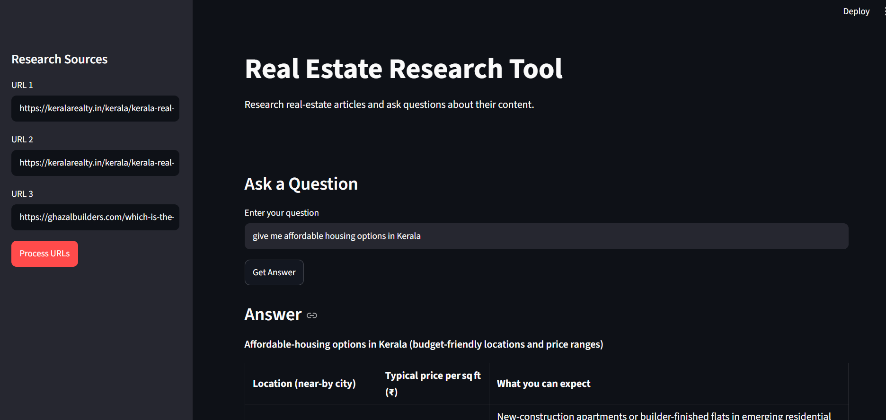

# Real Estate Research Assistant using RAG

A web-based research assistant that helps users ask questions about
real-estate and mortgage-related articles. It uses **Retrieval-Augmented
Generation (RAG)** to retrieve relevant text from user-provided URLs and
generate answers with source references.

> **Project status:** Learning / development project. The app is built
> with Streamlit, LangChain, Chroma, Hugging Face embeddings, and
> Groq-hosted language models.

## Table of Contents

-   [Overview](#overview)
-   [How It Works](#how-it-works)
-   [Tech Stack](#tech-stack)
-   [Project Structure](#project-structure)
-   [Requirements](#requirements)
-   [Setup](#setup)
-   [Environment Variables](#environment-variables)
-   [Run the Application](#run-the-application)
-   [How to Use](#how-to-use)
-   [Configuration](#configuration)
-   [Troubleshooting](#troubleshooting)
-   [Limitations and Responsible Use](#limitations-and-responsible-use)
-   [Future Improvements](#future-improvements)

## Overview

Researching several articles manually can take time. This project
provides a simple interface where users can submit article URLs, process
their content into searchable text chunks, and ask questions about the
collected information.

The application is designed to:

-   Accept up to three article URLs through the Streamlit sidebar.
-   Load web-page content and split it into smaller text chunks.
-   Convert text chunks into vector embeddings using a Hugging Face
    sentence-transformer model.
-   Store and retrieve the chunks using Chroma as the vector database.
-   Use a Groq-hosted large language model through LangChain to generate
    answers.
-   Display an answer and source information when the chain returns
    sources.

## Application Screenshot

The screenshot below shows the Streamlit interface, including the research-source URL inputs, question field, and generated answer.



## How It Works

The application follows a Retrieval-Augmented Generation workflow:

1.  **Enter URLs** --- provide one or more article URLs in the Streamlit
    sidebar.
2.  **Load content** --- LangChain's web loader retrieves the page
    content.
3.  **Split into chunks** --- the text splitter divides documents into
    smaller sections.
4.  **Create embeddings** --- `sentence-transformers/all-MiniLM-L6-v2`
    converts text into numerical vectors.
5.  **Store vectors** --- Chroma stores the chunks and their embeddings
    in a local persistent directory.
6.  **Ask a question** --- the question is passed to a
    retrieval-and-generation chain.
7.  **Retrieve relevant context** --- Chroma finds text chunks related
    to the question.
8.  **Generate an answer** --- the Groq language model uses the
    retrieved context to respond.
9.  **Show sources** --- source information returned by the chain can be
    displayed in the app.

### Architecture

``` text
User
 |
 v
Streamlit UI (main.py)
 |                         ^
 | URLs                    | Answer + sources
 v                         |
WebBaseLoader --> Text Splitter
                       |
                       v
             Hugging Face Embeddings
                       |
                       v
               Chroma Vector Store
                       |
                User's question
                       |
                       v
                Relevant chunks
                       |
                       v
              Groq LLM via LangChain
                       |
                       v
                Answer + sources
```

## Tech Stack

  Technology                           Purpose
  ------------------------------------ -------------------------------------------------
  Python                               Main programming language
  Streamlit                            Interactive web interface
  LangChain                            Document processing and RAG chain orchestration
  LangChain Community                  Web-page document loading
  LangChain Text Splitters             Splitting documents into chunks
  Chroma                               Persistent vector database for retrieval
  Hugging Face Sentence Transformers   Creating text embeddings
  Groq                                 Hosting and serving the language model
  python-dotenv                        Loading configuration from a `.env` file

### Models and Storage

-   **Embedding model:** `sentence-transformers/all-MiniLM-L6-v2`
-   **Chat model:** Configure a currently available Groq model in
    `rag.py`. The model ID `llama-3.3-70b-versatile` may no longer be
    available; check Groq's current model list before using a model ID.
-   **Vector-store directory:** `resources/vectorstore`
-   **Chroma collection:** `real_estate`

## Project Structure

The main files and directories are expected to follow this layout:

``` text
real-estate-assistant-using-rag/
├── main.py                 # Streamlit user interface
├── rag.py                  # URL processing, vector store, and RAG logic
├── requirements.txt        # Python dependencies and pinned versions
├── .env                    # API key and local environment configuration (not committed)
├── .gitignore              # Files excluded from version control
└── resources/
    └── vectorstore/         # Persisted Chroma data (generated at runtime)
```

Your exact repository may contain additional files or directories.

## Requirements

-   Python installed on your machine.
-   A Groq API key.
-   Internet access to retrieve the provided web pages and call the Groq
    API.
-   The Python packages listed in `requirements.txt`.

## Setup

### 1. Clone the repository

Replace the placeholder URL with your GitHub repository URL:

``` bash
git clone <YOUR_GITHUB_REPOSITORY_URL>
cd real-estate-assistant-using-rag
```

If you already have the project locally, open a terminal in the project
directory instead.

### 2. Create and activate a virtual environment (recommended)

**Windows PowerShell:**

``` powershell
python -m venv .venv
.\.venv\Scripts\Activate.ps1
```

If you already use a working virtual environment, you can continue using
it rather than creating another one.

### 3. Install dependencies

``` bash
python -m pip install -r requirements.txt
```

### 4. Configure your API key

Create a `.env` file in the project root:

``` dotenv
GROQ_API_KEY=your_groq_api_key_here
USER_AGENT=RealEstateResearchTool/1.0
```

Replace the example API key with your own. **Never commit your real API
key to GitHub.**

## Run the Application

Run Streamlit from the project directory:

``` bash
python -m streamlit run main.py
```

Streamlit will print a local URL, commonly:

``` text
http://localhost:8501
```

Open that URL in your browser.

> Do not launch the interface with `python main.py`. Streamlit apps
> should be started with `streamlit run` or `python -m streamlit run`.

## How to Use

1.  Open the app in your browser.
2.  Enter one or more article URLs in the sidebar.
3.  Select **Process URLs** and wait for processing to finish.
4.  Enter a question about the processed articles.
5.  Review the generated answer and any source information shown by the
    app.

For example, you could ask:

-   "What mortgage rate does the article report?"
-   "What date is associated with the reported rate?"
-   "How does the article explain changes in mortgage rates?"

The quality of an answer depends on the content successfully extracted
from the supplied pages and the context retrieved from the vector store.

## Configuration

The following settings are defined in `rag.py`:

  Setting             Purpose
  ------------------- -------------------------------------------
  `CHUNK_SIZE`        Maximum target size of a text chunk
  `EMBEDDING_MODEL`   Hugging Face model used to embed text
  `VECTORSTORE_DIR`   Directory used for persistent Chroma data
  `COLLECTION_NAME`   Name of the Chroma collection

The Groq model is configured when the `ChatGroq` client is initialized.
Choose a model that is currently available to your Groq account and
update the model ID in `rag.py` when needed.

## Troubleshooting

### Streamlit shows `missing ScriptRunContext`

The app may have been started as a normal Python script. Run it using:

``` bash
python -m streamlit run main.py
```

### `USER_AGENT environment variable not set`

Set `USER_AGENT` in `.env`, as shown in the environment-variable
section. Depending on how your loader is configured, you may need to
ensure the environment variable is loaded before the web loader makes
requests.

### `ModuleNotFoundError`

Install dependencies with the same Python interpreter that runs the app:

``` bash
python -m pip install -r requirements.txt
```

If multiple Python environments are installed, check which interpreter
is active:

``` bash
python -c "import sys; print(sys.executable)"
```

### Groq returns a model-not-found error

The requested model may have been retired or may not be enabled for your
account. Check the current model IDs in the [Groq
documentation](https://console.groq.com/docs/models), then update the
model setting in `rag.py`.

### A page cannot be loaded

Some sites block automated requests, require JavaScript, or limit
access. Try another publicly accessible article URL and check the site's
terms and access rules.

## Limitations and Responsible Use

-   Web-page extraction can fail or return incomplete text.
-   Answers are generated by an LLM and may be inaccurate or omit
    important details.
-   Sources are only as useful as the metadata returned by the loader
    and RAG chain.
-   The app is intended for research and learning, not as a substitute
    for professional financial, legal, or real-estate advice.
-   Respect website terms of service, robots policies where applicable,
    copyright, and request-rate limits.
-   Keep API keys private and out of version control.

## Future Improvements

Possible next steps for the project:

-   Add URL validation and clearer error messages for inaccessible
    pages.
-   Display retrieved passages alongside the answer for easier
    verification.
-   Add controls for chunk size, chunk overlap, and retrieval count.
-   Preserve previously indexed documents instead of clearing the
    collection whenever new URLs are processed.
-   Add tests for URL loading, chunking, retrieval, and answer
    generation.
-   Add document metadata, logging, and more robust exception handling.
-   Provide a deployment guide and screenshots of the application.

## Author

Add your name and profile links here:

-   **GitHub:** `<YOUR_GITHUB_PROFILE_URL>`
-   **LinkedIn:** `<YOUR_LINKEDIN_PROFILE_URL>`

------------------------------------------------------------------------

Built as a hands-on project to learn and practice Retrieval-Augmented
Generation (RAG), vector databases, embeddings, and LLM application
development with Python.
